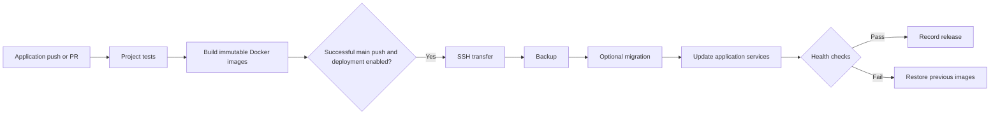

# Simple-pipe

A reusable GitHub Actions pipeline for existing Docker Compose applications on Linux servers. Keep application code in its own repository; use this repository for the deployment toolkit. No web dashboard or hosting service is required.



## Current status

Prepared for use; deployment defaults to **off**. Nothing is installed on any production server. The toolkit's own CI runs tests only. Each application must explicitly adopt the caller workflow and configure server hooks before enabling deployments.

## 1. Connect an application repository

1. Copy `examples/caller.yml` to the application's `.github/workflows/pipeline.yml`.
2. Replace **both** `PINNED_COMMIT` placeholders with the same reviewed full commit SHA from this repository.
3. Copy `examples/project.json` and `examples/ci.sh` to the application's `.simple-pipe/` directory. Configure its project name, Compose service names, build contexts, and Dockerfile paths. Paths are relative to the application repository root. Multiple services are supported; each configured service is built into its own image.
4. Replace the failing `ci.sh` placeholder with real dependency installation, linting, tests, and application build commands. This runs on Ubuntu with Docker, Python, Node and other GitHub-hosted runner tools; install any additional pinned runtime versions in this script. Tests needing PostgreSQL or Redis can start disposable containers and clean them up with a shell trap. Dockerfiles should use lockfiles and multi-stage production builds.
5. Leave `deploy: false` while reviewing the checks.

Simple-pipe is currently private. Allow selected application repositories to use its reusable workflows under **Settings → Actions → General → Access**. Also supply `TOOLKIT_READ_TOKEN`, a fine-grained token with read-only Contents access to Simple-pipe, for checkout from a different private repository. The ordinary application `GITHUB_TOKEN` cannot check out another private repository. Public toolkit repositories do not need this extra token. Fork PRs do not receive this secret and may fail toolkit checkout; this pipeline does not use `pull_request_target` to expose credentials to fork code.

## 2. Prepare a server separately

Prerequisites: Linux x86-64, Python 3.11+, Docker Engine, Compose v2 supporting `up --wait`, OpenSSH, and enough disk space for both old and new images plus temporary archives. Builds run on x86-64; ARM servers need a separate build strategy. The deployment account must be able to run Docker and write its application directory. Docker access is effectively root-equivalent: use a dedicated restricted deployment identity and trusted main-branch changes. This toolkit does not install users, runners, sudoers rules, packages, or SSH keys.

Prepare this layout, adapting `/srv/my-app`:

```text
/srv/my-app/
  project-name          # one line: my-app
  compose.yml           # existing production topology and persistent volumes
  .env                  # server-only secrets, mode 600
  hooks/
    backup              # mandatory executable; creates a recoverable backup
    health              # mandatory executable; checks application readiness
    migrate             # optional executable; backward-compatible migrations
  .simple-pipe/         # created by toolkit: lock, image overrides, release history
```

Set `project-name` to BOTH the application's config project name and its **existing Docker Compose project name**. A different project name creates a different stack and potentially different volumes. The base Compose file must contain exactly the service names configured for deployment. Start those services with a known-good release first; the toolkit requires one existing container per configured service so it can capture rollback image IDs. Bootstrapping a new application is a separate initial operation.

Adapt the examples under `examples/hooks/` and install them on the server with executable permissions. Backup and health placeholders require configuration. Hooks execute from the application directory and receive `SP_DIRECTORY`, `SP_PROJECT`, `SP_SHA`, and `SP_OVERRIDE`. A migration must explicitly include the candidate override when running the new image; see `migrate.example`. Server configuration and hooks are managed separately, and are not overwritten from application commits.

Use stable named volumes or bind mounts for data. The toolkit never runs `compose down`, deletes volumes, updates the database/proxy, or prunes images. Only the services listed in the application config are updated, with `--no-deps`. Schedule disk monitoring and reviewed image/artifact cleanup separately. Artifact retention on GitHub is seven days; deployment metadata remains on the server.

## 3. Configure application secrets and network access

Create a GitHub **production** environment in the application repository. Add appropriate approval rules if your plan supports them. Add these secrets (repository-level secrets also work):

| Secret | Value |
| --- | --- |
| `DEPLOY_HOST` | Server IP or hostname |
| `DEPLOY_USER` | Dedicated SSH deployment user |
| `DEPLOY_PORT` | Optional SSH port, defaults to 22 |
| `DEPLOY_DIRECTORY` | Absolute application directory, e.g. `/srv/my-app`; no spaces |
| `DEPLOY_SSH_KEY` | Dedicated private deployment key, never a personal key |
| `DEPLOY_KNOWN_HOSTS` | SSH known_hosts entry verified against the server console or another trusted channel |
| `TOOLKIT_READ_TOKEN` | Private toolkit checkout token, as described above |

Do not blindly trust a live `ssh-keyscan` result. Verify the server fingerprint independently before saving its known_hosts entry. For a nonstandard port, use the `[hostname]:port` known_hosts syntax.

GitHub-hosted runners cannot directly reach a private address such as `100.82.245.119`. For private networks, provision a **separate dedicated Linux deployment runner** with SSH network access and set the caller's `runner` input to its labels, as shown in the example. Tests and builds remain on GitHub-hosted runners; only the gated deployment job uses the network runner. It needs Python 3.11+, `gh`, `ssh`, `scp`, and `tar`, but no local Docker privileges. Do not use the production host itself as this runner without separately reviewing that choice. Runner installation is outside this prepared toolkit and has not been performed. Alternatively, adapt the deployment job to join an approved VPN before SSH.

The reusable workflow declares `environment: production` on the deployment job, so environment secrets and approvals apply there. Keep `TOOLKIT_READ_TOKEN` at repository level because the test job also needs it. Pass secrets explicitly using the example caller.

## 4. Enable continuous deployment

After a green test build and server preparation, change the application caller to `deploy: true` in a reviewed main-branch change. Pushes to `main` test, build, retain a release, and deploy. PRs test and build but never deploy. A failing test/build blocks deployment. GitHub serializes production jobs, and the server uses a file lock and monotonically increasing workflow run number to reject stale releases. Keep the application's workflow identity stable: renaming/replacing it may reset the numbering and requires a reviewed reset of server `current.json`.

Protect `main` and require successful CI checks where your GitHub plan permits. Anyone able to change trusted application CI/Dockerfiles or the pinned toolkit can influence production. SHA pinning makes toolkit upgrades explicit; update both caller pins together after review.

## Recovery and limits

The server verifies the archive's image checksum and each image revision label. These checks detect corruption and mismatched images; authenticity comes from the trusted workflow and pinned SSH transport, not an independent release signature.

Before switching images, the server captures actual running image IDs, loads the new images, and calls the backup hook. Backup failure stops deployment. Migration failure stops the image switch. Partial Compose failure or failed readiness checks trigger restoration of the captured application images; a failed recovery fails the job too. Database migrations are **never** automatically reversed. Use additive/backward-compatible migrations so old images remain usable. Restoring data from backup is an explicit incident operation; a migration can partially change a database even when it exits unsuccessfully.

This is a rolling replacement using Compose, not zero-downtime blue/green deployment. A network interruption, runner cancellation, host restart, or process kill can interrupt a deployment without executing recovery. Inspect Docker state and `.simple-pipe/` metadata before retrying. Automatic rollback covers handled command failures, not abrupt process termination. A successful update records `current.json`, `active.json`, and appends `history.jsonl`; `rollback.json` contains the previous image IDs. Later manual Compose operations must include `.simple-pipe/active.json` to keep the deployed version:

```bash
docker compose --env-file /srv/my-app/.env -p my-app \
  -f /srv/my-app/compose.yml -f /srv/my-app/.simple-pipe/active.json ps
```

The release contains image layers and metadata only, not application `.env` files or database backups. Dockerfiles must exclude secrets from their build contexts with `.dockerignore`. Very large images may exceed GitHub artifact limits or runner/server storage.

## Development

```bash
python3 -m unittest discover -s tests -v
bash -n examples/ci.sh examples/hooks/backup examples/hooks/health examples/hooks/migrate.example
```

Unit tests mock Docker/SSH and cover transaction ordering, rollback, backup failure, checksums, stale releases, and unsafe connection arguments. CI also boots a disposable Compose stack, promotes a built image, and verifies image restoration after a deliberately failed readiness check. Neither test certifies a live SSH deployment. Test an application's hooks and first deployment on staging before enabling production.

References: [GitHub reusable workflows](https://docs.github.com/en/actions/how-tos/reuse-automations/reuse-workflows), [Docker Compose up](https://docs.docker.com/reference/cli/docker/compose/up/).
